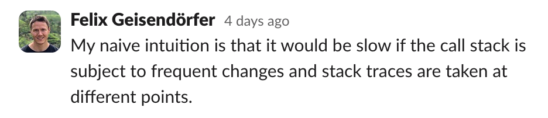
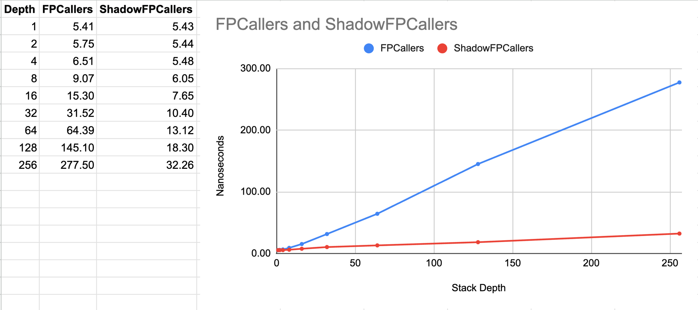
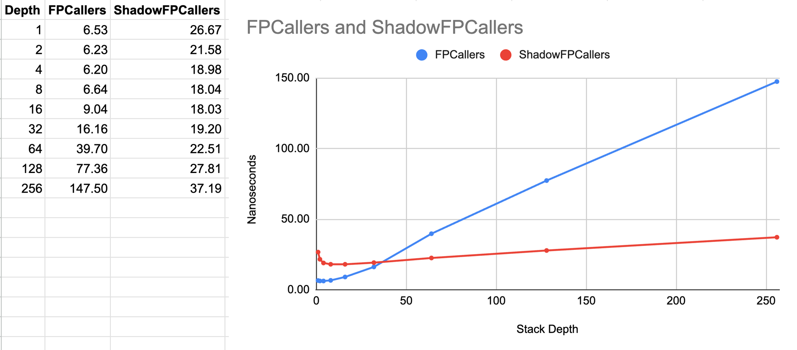

**tl;dr**: Software shadow stacks could deliver **up to 8x faster stack trace capturing** in the Go runtime when compared to the frame pointer unwinding that landed in go1.21. This doesn't mean that this idea should escape from the laboratory right away, but it offers a fun glimpse into a potential future of hardware accelerated stack trace capturing via shadow stacks.

## Inspiration

A couple of days ago I came across an [interesting comment](https://news.ycombinator.com/item?id=40456666) from the author of the [Bytehound profiler](https://github.com/koute/bytehound) on Hacker News. The comment was in response to somebody asking if the fast stack trace capturing technique mentioned in the project's README is based on frame pointers. The response was:

> No. It's DWARF based.\
> \
> The main two tricks are: it preprocesses all of the DWARF info at startup for faster lookups, and it dynamically patches the return addresses of functions on the stack injecting an address to its own trampoline, which allows it to skip going through the whole stack trace every time it needs to dump a backtrace

## Background

Before we get into the gnarly details, let's briefly remember that capturing a stack trace for a native language such as C/C++/Go/Rust is essentially the act of traversing all call frames on the stack and collecting the return addresses that are stored inside of them.

The simplest way to do this is via a compiler (option) that adds a preamble to every function, causing it to push a pointer to the previous frame onto the stack. This effectively turns the stack frames into a linked list and allows for very [fast stack trace capturing](/2023/01/31/reducing-gos-execution-tracer-overhead-with-frame-pointer-unwinding/) which I helped to [implement for go1.21](/2023/06/30/waiting-for-go1-21-execution-tracing-with-less-than-one-percent-overhead/).

However, for legacy reasons going back to the days when we had only 32bit CPUs with limited registers, compilers other than Go generally omit frame pointers for optimized builds (`-O1` or greater). The tide on this is [currently turning](https://www.brendangregg.com/blog/2024-03-17/the-return-of-the-frame-pointers.html), but for the time being, in many cases DWARF or other unwind tables have to be used in order to lookup the distance between the frames of the stack.

Since DWARF unwind tables are expressed in terms of opcodes for a Turing-complete VM (I wish I was making this up), it's pretty common to preprocess this data for better lookup performance. In fact, there is a [neat paper](https://dl.acm.org/doi/10.1145/3360572) that goes as far as directly precompiling these unwind tables into x86_64 code. I'm not sure if that's the kind of preprocessing the Bytehound profiler does, but it doesn't really matter.

Because at the end of the day, no matter how well this kind of preprocessing is done, frame pointer unwinding tends to outperform these approaches by at least an order of magnitude. Pitting a table lookup against linked list traversal is simply like bringing a knife to a gun fight ... or so I thought.

It turns out that the main advantage of a gun is to quickly attack a target over a distance. But, as we'll now explore, the second trick mentioned by the Bytehound author is to shrink the distance between the knife and the gun, turning the situation into more of a close-quarter combat.

## Shadow Stacks

So, what do I mean by shrinking the distance? Well, it turns out that the act of repeatedly capturing stack traces often involves a lot of duplicated work. That's because most of the time only a few leaf frames have changed in between two stack traces being captured, yet we end up re-traversing the unchanged frames over and over again. This insight naturally leads to the idea of maintaining a cache of return addresses that allows us to avoid this duplicate work at the cost of maintaining the cache. Such a cache is also know as a "shadow stack".

One way to maintain such a shadow stack is to push return addresses to both the normal as well as the shadow stack for every function call and to pop addresses from both places upon return. This could be managed by the compiler, but would add a fixed cost to all function calls and returns that is likely to be significantly larger than the act of pushing a frame pointer. Alternatively this could be done by hardware, and it turns out this has [recently landed](https://www.phoronix.com/news/Intel-Shadow-Stack-Linux-6.6) as a security feature for modern Intel CPUs in the Linux kernel.

But as far as I can tell, it's [not yet possible](https://docs.kernel.org/next/x86/shstk.html) to access these hardware shadow stacks from user space, nor is the technology widely available at this point. So until I saw the comment from Bytehound's author, I had assumed that shadow stacks would not be a feasible user space technique.

It turns out that I was wrong. An alternative approach is to populate a shadow stack when a stack trace is captured. This eliminates the overhead of having to update the shadow stack for every function call. However, it still leaves the problem of popping return addresses when the function that populated the cache returns. This is where the clever trampoline trick from the Bytehound author comes in. The idea is to exploit the very security problem hardware shadow stacks are supposed to prevent, and overwrite return addresses on the stack to inject a trampoline function that pops an address from the shadow stack before returning control to this address.

I was immediately intrigued by the potential of this idea. In theory it seems like it could amortize most of the costs associated with DWARF unwinding on the happy path. However, I was skeptical how well the approach would fare under what I imagined to be a worst-case workload.

<figure>
  
  <figcaption>Message from an internal slack channel at work</figcaption>
</figure>

## Implementing Shadow Stacks in Go

One of the things I like about my org at Datadog, is that we do research weeks regularly. During those one week periods, we are encouraged to learn new things or research difficult problems. I didn't find much time last week for this yet, but trying out a potentially feasible shadow stack technique was too exciting for me to pass up, so I got to work.

My goal was to see if it was possible to use the shadow stack idea to accelerate frame pointer unwinding in Go even further. Unlike DWARF, frame pointers don't really need any additional acceleration, but I figured it would be a fun challenge.

So I decided to implement a `ShadowFPCallers` function that combines frame pointer unwinding and shadow stacks, and benchmark it against a regular frame pointer unwinding function called `FPCallers`.

You can see the full source code [here](https://go-review.googlesource.com/c/go/+/588615), but the core of the implementation is rather simple. First I added a new `shadowStack` field to the goroutine struct `g`. I also declared a new type for it thinking I'd need multiple fields. But I ended up just needing a single `pcs []uintptr` field.

``` go
type g struct {
  ...
  shadowStack
}

type shadowStack struct {
    pcs []uintptr
}
```

The `ShadowFPCallers` function is a little more complex, but generally speaking it's a frame pointer unwinding loop that injects a special `shadowTrampolineASM` return address and uses it as a marker to realize that the rest of the return addresses can be copied from the shadow stack. It's also smart enough to incrementally update the shadow stack when the stack depth increases.

``` go
func ShadowFPCallers(pcs []uintptr) (i int) {
    const shadowDepth = 2
    var (
        gp           = getg()
        fp           = unsafe.Pointer(getfp())
        oldShadowPtr unsafe.Pointer
        newShadowPtr unsafe.Pointer
    )
    for i = 0; i < len(pcs) && fp != nil; i++ {
        pcPtr := unsafe.Pointer(uintptr(fp) + goarch.PtrSize)
        pc := *(*uintptr)(pcPtr)
        if i == shadowDepth {
            newShadowPtr = pcPtr
        }
        if pc == abi.FuncPCABIInternal(shadowTrampolineASM) {
            i += copy(pcs[i:], gp.shadowStack.pcs)
            oldShadowPtr = pcPtr
            break
        }
        pcs[i] = pc
        fp = unsafe.Pointer(*(*uintptr)(fp))
    }
    if oldShadowPtr == newShadowPtr {
        return
    }
    if oldShadowPtr != nil {
        *(*uintptr)(oldShadowPtr) = gp.shadowStack.pcs[0]
    }
    gp.shadowStack.pcs = append(gp.shadowStack.pcs[0:0], pcs[shadowDepth:i]...)
    *(*uintptr)(newShadowPtr) = abi.FuncPCABIInternal(shadowTrampolineASM)
    return
}
```

The `shadowTrampolineASM` function itself is a thin wrapper around a `shadowTrampolineGo` function. Together they take care of popping an address from the shadow stack, injecting the trampoline into the parent caller and restoring the popped address in the link register `R30` (arm64).

```
TEXT ·shadowTrampolineASM<ABIInternal>(SB),NOSPLIT|NOFRAME,$0-0
    CALL runtime·shadowTrampolineGo<ABIInternal>(SB)
    MOVD R0, R30
    RET
```

``` go
func shadowTrampolineGo() (retpc uintptr) {
    gp := getg()
    retpc = gp.shadowStack.pcs[0]
    gp.shadowStack.pcs = gp.shadowStack.pcs[1:]
    *(*uintptr)(unsafe.Pointer(getcallersp())) = abi.FuncPCABIInternal(shadowTrampolineASM)
    return
}
```

Last but not least, I had to teach Go's lookup table unwinder how to navigate the injected trampoline functions. Without that change, `panic()`, `copystack()` and the cpu/memory profiler would break due to the unwinding getting stuck.

``` go
func (u *unwinder) resolveInternal(innermost, isSyscall bool) {
    // ...
    if f.funcID == abi.FuncID_shadowTrampolineASM || f.funcID == abi.FuncID_shadowTrampolineGo {
        frame.pc = gp.shadowStack.pcs[0]
        frame.fn = findfunc(frame.pc)
        f = frame.fn
    }
    // ...
```

It took quite a bit of hacking to get the details right, but as far as I can tell, the implementation seems to be working.

This allowed me to do some benchmarking. The first benchmark shown below is a best-case scenario of capturing stack traces in a loop at a fixed stack depth. As you can see, the `ShadowFPCallers` approach is **8x faster** than the `FPCallers` implementation which is already really fast 🚀.

<figure>
  
  <figcaption><strong>Best-case:</strong> Regular FPCaller unwinding vs ShadowFPCallers</figcaption>
</figure>

But as suspected, performance is mixed when it comes to a worst-case benchmark where the stack depth is increased up to a limit and then decreased back down while taking a stack trace upon entering a certain depth level as well as when leaving it. Here it seems like the shadow stack approach is only competitive for stacks that are a little deeper than 32 frames. At lower stack depths, the approach is **up to 4x slower** 🐌.

<figure>
  
  <figcaption><strong>Worst-case:</strong> Regular FPCaller unwinding vs ShadowFPCallers</figcaption>
</figure>

I can think of a few ways to mitigate the worst-case scenario. For example, the shadow stack could be disabled for stack depths below 32 frames. Or perhaps we could keep some statistics about the stack depths and use some more advanced heuristics. The implementation itself could probably also be further optimized. But, since this was just a small side project, I didn't have time to explore this further.

## Conclusion

Software shadow stacks are a potentially viable technique for accelerating stack trace capturing. I have only measured the approach on top of frame pointer unwinding in Go, but I would imagine DWARF unwinding to also become very competitive with this acceleration. And while it wasn't easy to get right, the approach requires relatively little additional code.

However, the approach also comes with a lot of downsides, in particular:

1.  Worst-case performance can be problematic at lower stack depths. (But it's not clear how often this will be encountered in the wild).
2.  Upcoming hardware security features will likely break this approach.
3.  External unwinders (such as linux perf) will produce broken stack traces when encountering the manipulated return addresses.
4.  Programs using similar bespoke control-flow techniques might break when running them with shadow stacks.
5.  Great care needs to be taken to avoid breaking unwinding for panics, exceptions and similar situations.
6.  Shadow stacks require 8 bytes of additional memory per stack frame. This should usually be fine, but some programs might not want to make such a tradeoff.

Considering that frame pointer unwinding is less than a few percent of overhead for Go's execution tracer, which is the most demanding use case we have, my conclusion is that the technique is interesting, but not warranted at this point.

My personal hope is that hardware shadow stacks will become widely available and accessible from user space. This is probably still many years away, but once this future arrives, we should be able to get rid of DWARF unwinding and perhaps also frame pointers and enjoy blazing fast stack trace capturing across the board.

## Online Discussions

- [Reddit](https://www.reddit.com/r/golang/comments/1d2h33i/blazingly_fast_shadow_stacks_for_go/)
- [Hacker News](https://news.ycombinator.com/item?id=40509535)
