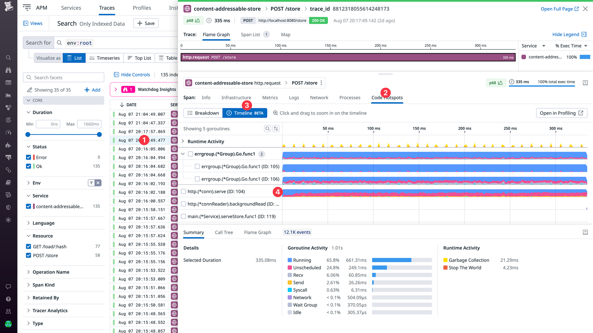
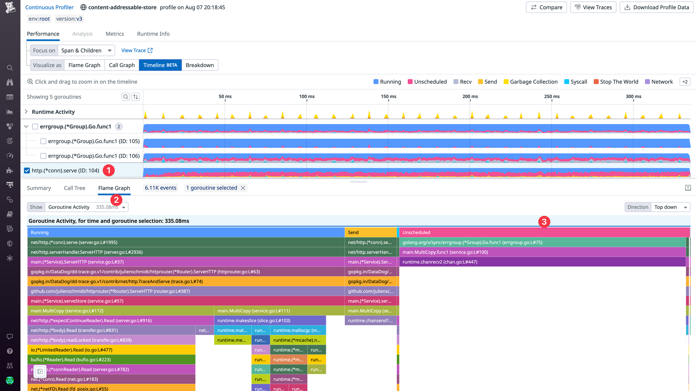
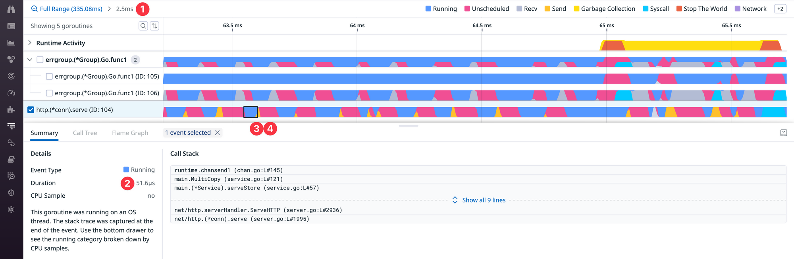
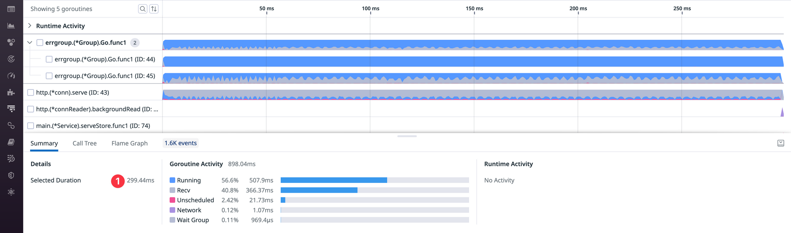

Have you ever found yourself wrestling with a slow p95 request or timeout in a Go application, desperately seeking that elusive root cause? Were you frustrated by the limited capabilities of existing tools? Would you have loved to have a detailed timeline for the involved goroutines showing you how they spend their time running On-CPU or waiting Off-CPU due to networking, disk access, mutex contention, channel operations, garbage collection or scheduler latency?

If yes, you'll probably be interested in Datadog's new [timeline feature](https://docs.datadoghq.com/profiler/connect_traces_and_profiles/?code-lang=go#span-execution-timeline-view) for Continuous Profiler which is now in public beta for Go (as well as for Java and .NET). I've been working on this with my colleagues for a few months now, and we're very excited about rolling it out.

The feature works best if you have basic request instrumentation with Datadog APM. To get started, upgrade to [dd-trace-go](https://github.com/DataDog/dd-trace-go) v1.52.0+ and set the following environment variables:

``` go
os.Setenv("DD_PROFILING_EXECUTION_TRACE_ENABLED", "true")
os.Setenv("DD_PROFILING_EXECUTION_TRACE_PERIOD", "15m")
```

Once this is enabled, you'll be able to click on slow requests in APM ❶ and navigate to the `Code Hotspots` ❷ → `Timeline` ❸ tab in order to see a timeline of every goroutine that was involved in serving this request. In the default zoom level, we aggregate events of the same type into small time buckets that are rendered as colorful area charts ❹.

<figure>
  
  <figcaption>Viewing the timelines of the goroutines involved in a request</figcaption>
</figure>

The displayed data can be sliced and diced by selecting specific goroutines, time ranges and visualizations. For example, in the screenshot below I selected goroutine 104 (`http.(*conn).serve`) ❶ and opened the Flame Graph ❷ in the bottom drawer in order to understand what code is being executed.

<figure>
  
  <figcaption>Viewing the Flame Graph of an individual goroutine. <em>Running</em> is On-CPU, the rest if Off-CPU.</figcaption>
</figure>

One thing to notice is the high amount of *Unscheduled* time ❸ which indicates that the selected goroutine was experiencing scheduler latency. This can happen when all CPUs (GOMAXPROCS) are busy, but that wasn't the case here.

To figure out the problem, we can zoom in to a 2.5ms time window ❶ and notice a pattern of spending only ~50 microseconds running ❷ before getting blocked by a send operation ❸ followed by a similar amount of unscheduled time ❹.

<figure>
  
  <figcaption>Zooming into the timeline of a goroutine to see individual scheduling events.</figcaption>
</figure>

Arguably this behavior from the scheduler doesn't seem ideal, but instead of going down this rabbit hole (we'll do it another time), we can simply increase the batch size of the individual messages that are being sent over the channel.

This greatly reduces the number of times the goroutine has to be scheduled, which leads to a much smoother execution schedule and improves the latency of the endpoint by ~10% (335ms → 299ms ❶). This can be seen in the screenshot below, but you can also check out the [source code and commits of this application](https://github.com/DataDog/content-addressable-store/commits/main) for more details.

<figure>
  
  <figcaption>Increasing the batch size of our messages eliminated the scheduling latency we saw earlier.</figcaption>
</figure>

Of course this is just a small example of how you can use this feature. In practice there are many different things that can cause latency problems (network, disk, mutex contention, channel operations, garbage collection, etc.), and it's not always practical or even feasible to instrument all of them with APM. But with the profiling timeline there is no need for additional instrumentation – we can finally give you full visibility into everything. This should help you to resolve even the most challenging latency problems.

For Go, we're using the builtin execution tracer (aka [runtime/trace](https://pkg.go.dev/runtime/trace)), which lets us capture extremely detailed data that goes far beyond our [previous approach](https://felixge.de/2022/02/11/connecting-go-profiling-with-tracing/) of correlating CPU profiling data to our distributed traces using pprof labels.

One aspect that we're very proud of is the low overhead. Historically Go's execution tracer came with some noticeable overhead, so we [contributed patches](/2023/06/30/waiting-for-go1-21-execution-tracing-with-less-than-one-percent-overhead/) to the Go runtime to reduce this overhead to \< 1% using the [forgotten art of frame pointer unwinding](/2023/01/31/reducing-gos-execution-tracer-overhead-with-frame-pointer-unwinding/). So please upgrade to the recently released go1.21 if overhead is a big concern for you.

To keep data volumes under control, we currently capture these execution traces for up to 1 minute (or 5 MiB) every 15 minutes. If you click on a span without data, our UI will guide you to similar spans that have coverage. Alternatively you can also find such spans by adding the `@go_execution_traced:yes` filter in the search bar.

At this point we've already gotten a lot of value out of this feature internally, but we're even more excited to hear about your experiences and success stories. Please let us know what you think!

**Update**: We've also released a 10 minute video showing this feature in action, you can check it out below:

<iframe class="video" src="https://www.youtube-nocookie.com/embed/6MOtFkl2tq0" title="Optimizing Go Request Latency with Datadog's Profiling Timeline" width="560" height="315" loading="lazy" allow="encrypted-media; picture-in-picture; fullscreen" referrerpolicy="strict-origin-when-cross-origin" allowfullscreen></iframe>

------------------------------------------------------------------------

*Disclaimer: This is my personal blog, so I'm not barking on behalf of my employer in an official capacity here.*
