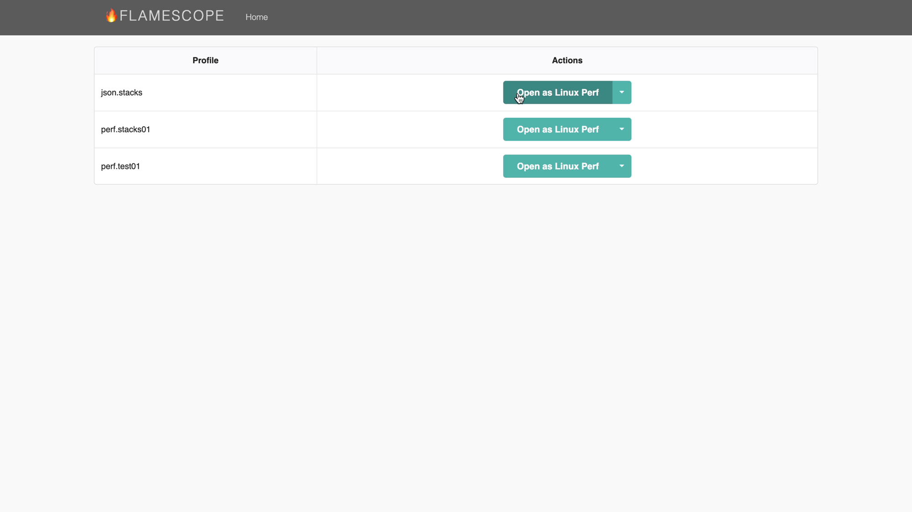
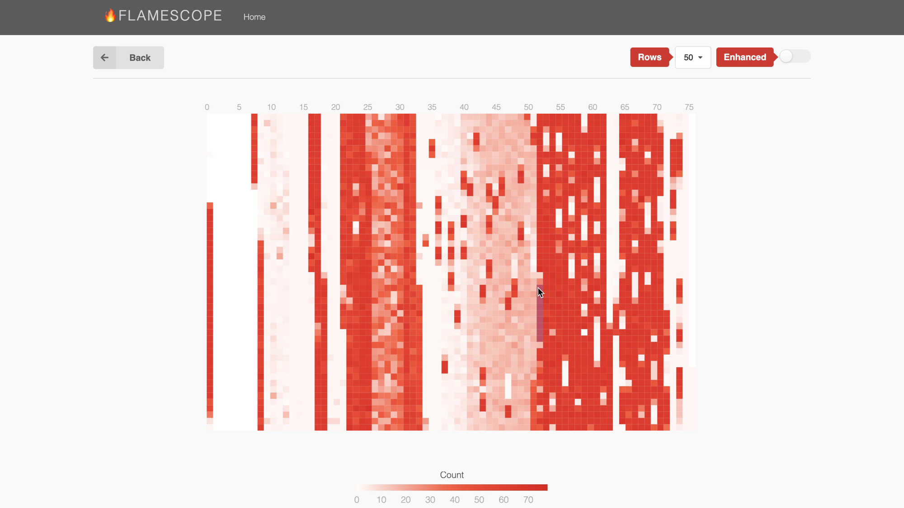
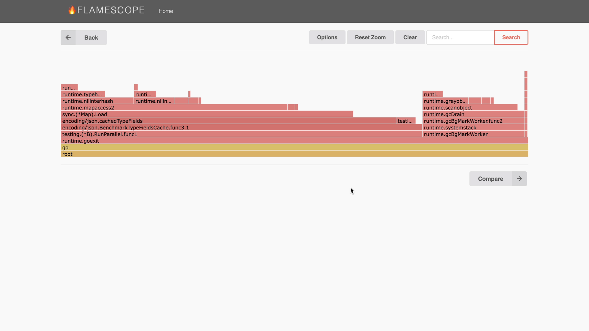

[FlameScope](https://github.com/Netflix/flamescope) is a wonderful performance visualization tool from Netflix. If you have never heard about it, you should start by reading Brendan Gregg's [FlameScope  Pattern Recognition](https://www.brendangregg.com/blog/2018-11-08/flamescope-pattern-recognition.html) blog post as an introduction.

But as Go developer, you might have not have had a chance to use it because [pprof profiles don't contain timestamps](https://github.com/google/pprof/pull/728). Using Linux perf is an option, but that may not always be available in your environment.

However, thanks to a [patch](https://go-review.googlesource.com/c/go/+/400795) from Rhys Hiltner, go1.19+ execution traces include CPU samples with timestamps when when having the CPU profiler enabled. The only thing missing, until now, was a way to extract these CPU samples, so they can be visualized in FlameScope.

So I spend some time this weekend to implement FlameScope support for my [traceutils](https://github.com/felixge/traceutils#flamescope) project. You can follow the steps below to install it, and create an example `json.stacks` file by running the `encoding/json` benchmarks:

``` bash
# install traceutils
go install github.com/felixge/traceutils/cmd/traceutils@latest

# record an example trace with CPU samples
go test -bench . -cpuprofile /dev/null -trace json.trace encoding/json

# convert it to the format used by perf script
traceutils flamescope json.trace json.stacks
```

The next thing you need to do is installing FlameScope itself. The steps below should work if you're on an M1 MacBook Pro.

    # clone repo
    git clone https://github.com/Netflix/flamescope
    cd flamescope

    # add the json.stacks file
    mv ../json.stacks examples

    # install libmagic
    brew install libmagic

    # install python deps
    pip install -r requirements.txt

    # build ui
    npm install
    npm run webpack

    # run flamescope
    python run.py

Once you've got it up and running, you should be able to select the `json.stacks` file by hitting the `Open as Linux Perf` button next to it.



This will bring up the FlameScope heatmap. You can use it to select one of the hot parts of the profile as shown below.



This will bring up a FlameGraph for the selected time range. In this case the `RunParallel` frame near the bottom of the stack explains why this part of the profile was hot: The benchmark was executing on all of our CPUs.



And that's it, you can now enjoy FlameScope visualizations using Go.

But please note that this is still relatively experimental and I've identified at least [one problem](https://github.com/golang/go/issues/58877) while using it so far. Also note that CPU profiling on macOS is [a bit broken](https://github.com/golang/go/issues/57722) these days, so you should prefer to collect this kind of data on Linux.

Anyway, hopefully you'll find this new tooling useful for exploring the performance of your Go applications. Please let me know in the comments, [reddit](https://www.reddit.com/r/golang/comments/11jzie0/flamescope_for_go/), [twitter](https://twitter.com/felixge/status/1632740029985439744), or [mastodon](https://home.social/@felixge/109976668192182422).
