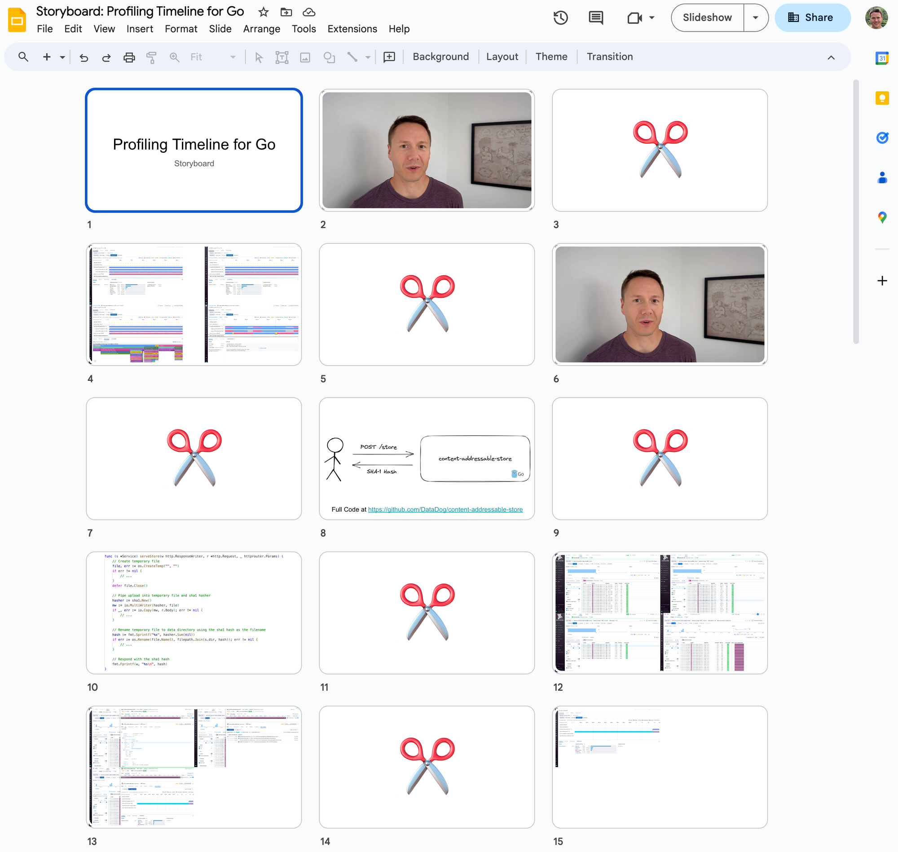
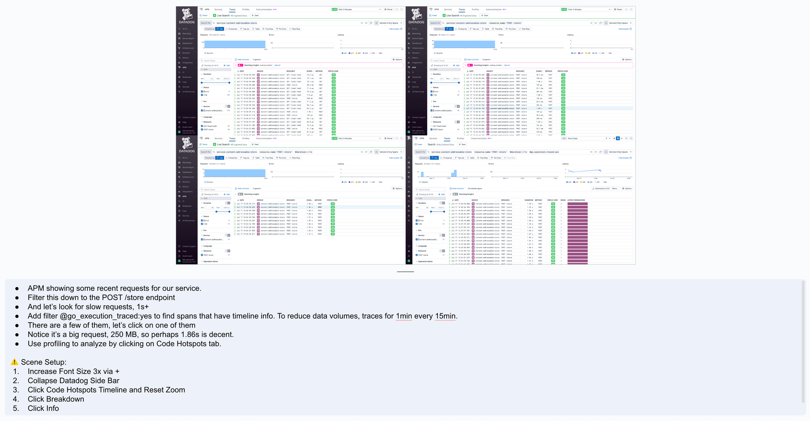
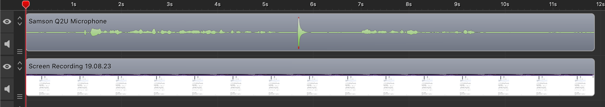

My team recently shipped a new [profiling feature](/2023/08/09/debug-go-request-latency-with-datadogs-profiling-timeline/) that we're very excited about. The feature is highly interactive and capable of slicing and dicing through tons of data. This makes it difficult to show the full experience with text and screenshots. So I decided to create a video that shows the tool in action.

[Optimizing Go Request Latency with Datadog's Profiling Timeline](https://www.youtube.com/watch?v=6MOtFkl2tq0)

This blog post explains how I made this video.

You can see the video above, and I think it turned out reasonably well. The feedback was also positive, including the quote below:

\> \[...\] you need to teach the rest of us what goes into making such awesome videos.

I'm definitely no expert, but in this post I will share the things I learned that will help you getting started.

## Create a Storyboard

In my opinion, telling a good story is the most important part of making a video. You can get away with poor production quality, but not with a boring story.

To plan my story, I created a storyboard using Google Slides. I initially put some bullets on the slides to create a rough outline. Then I hacked on my [demo application](https://github.com/DataDog/content-addressable-store) to try out the ideas I had and took screenshots to replace the bullets.

Using Google Slides for creating a storyboard

Finally I used the speaker notes to outline the things I wanted to say, as well as other reminders for the recording process.

Using speaker notes for the script and recording notes

I found the storyboard very helpful with planning the recording. In particular it allowed me to split the video into smaller takes that are easier to shoot than longer ones.

However, I didn't always follow the storyboard religiously and would sometimes make last minute changes to a scene without updating the board. Plans are worthless, but planning is everything.

## Recording Strategy

Initially I tried to record my screen first and then record the voice-over tracks separately. This worked, but I ran into two issues:

- **Too much editing**: I had to insert a lot of freeze frames in order to synchronize the things happening on the screen with my voice.
- **Bad delivery**: I struggled with sounding excited and natural when reading from a script.

So I gave up on this approach and recorded the screen and audio for each scene at the same time. But this led to a lot of mistakes. The best way to handle them is to take a deep breath, clap your hands, and then continue where you left off. Don't stop the recording, even if you have to reset things on the screen and go back a little. Instead edit out the bad parts once you think you have enough good material. To speed up the editing process, look for the distinct patterns of clapping your hands in the audio track:

Clapping is an easy way to leave visual markers in your audio track

I'm happy this approach, but one disadvantage is that it produces longer videos. Speaking freely simply produces more redundant words and pauses than a tightly scripted narration track.

I also found it also hard to say exactly what I had planned, so in some cases I'm not happy with the words I ended up choosing. For example at one point I'm saying "followed by" while talking about sibling nodes in a FlameGraph. This could give listeners the wrong impression that the X-Axis of a FlameGraph represents chronological ordering. But I decided it's not worth reshooting the whole scene to fix this.

## Get Early Feedback

While recording and editing the first version of the video, I started to doubt myself. So instead of continuing, I shared 4 minutes of incomplete material with my colleagues. Based on their feedback, I ended up making many good changes, for example:

- Significantly increase the font size. It was unreadable on smaller screens.
- Kill the the recap about profiling. Everybody hates videos that take forever to get to the point.
- Use a different camera angle for the intro. My hands looked really weird behind the mic.
- Don't wear AirPods, it looked weird.
- Don't try to read out a script word by word, my delivery and intonation is better when speaking freely. Your milage may vary on this.
- Collapse the left-side Datadog navigation to get more screen real estate.
- Highlight the elements on the screen you are talking about.

You can see the first version of the video that I ended up discarding below:

[2023 06 04 Profiling Timeline Beta Promo](https://www.youtube.com/watch?v=SUL7fFBn6D8)

Early and incomplete footage I shared with colleagues to get feedback

## Resolution vs Font Size

You need to make sure your videos can be watched on smaller laptop screens, and ideally phone screens. If you use a large screen for recording, you need to either lower your resolution or increase the font size.

I was mostly recording my browser window in full screen mode. So I ended up increasing the font size. The benefit of this approach is that you don't need to switch your resolution back and forth.

Either way, I recommend that you shoot everything in 4k. This especially helps with achieving crisp font display.

## Software

I used a commercial video recording and editing software called ScreenFlow. It has a few nice features that are specific to editing screen recordings, but they were not important for producing this video. The main feature I liked for this project is the ability to record from multiple screens, cameras and microphones at the same time.

In the past I've also used QuickTime Player for recording and the free version of [DaVinci Resolve](https://www.blackmagicdesign.com/products/davinciresolve) for editing. I highly recommend this combination if you don't want to spend any money. The only downside is that learning DaVinci takes a little more time. It's a tool aimed at professionals and not optimized for editing screen recordings.

To create the thumbnail for the video, I extracted a frame from my intro section and removed the background using remove.bg. Then I used photopea (a free web clone of photoshop) to combine it with a screenshot.

## Hardware

My current laptop is a maxed out 16" M1 MacBook Pro. I found it significantly more performant than my previous Intel MBPs for editing video. During recording and editing I had the laptop hooked up to a 27 inch LG UltraFine 5K Monitor.

For audio I use a Samson Q2U. It's a dynamic microphone which means that it's less prone to pick up background noise compared to a condenser microphone.

For the camera shots I used my iPhone 13 Pro with a tripod. I also used the Continuity Camera feature of macOS to avoid having to transfer the videos I record. For audio I used my Samson Q2U rather than the iPhone to keep the audio track consistent.

## It Takes Time

I won't sugarcoat this. Producing video is hard. Much harder than writing.

Your milage will vary, but I spent almost a week to produce 10 minutes of content. Over half of the time was spent on creating the story as well as iterating on the [example application](https://github.com/DataDog/content-addressable-store) shown in the video. I wrote a lot of code that I ended up throwing away. In particular, I initially attempted to build a full application with multiple endpoints. But then I realized that focusing on one endpoint will create a better story and keep the video shorter.

The rest of the time went into recording and editing. But this part gets easier with experience. Even within this project, I noticed how I was moving much faster towards the end.

## Feedback Welcome

The video is definitely far from perfect, but I hope that this post contained some useful information for other non-professional tech video creators.

If you have any questions or suggestions for producing better videos, please leave a comment. Either way, thank you for reading!
