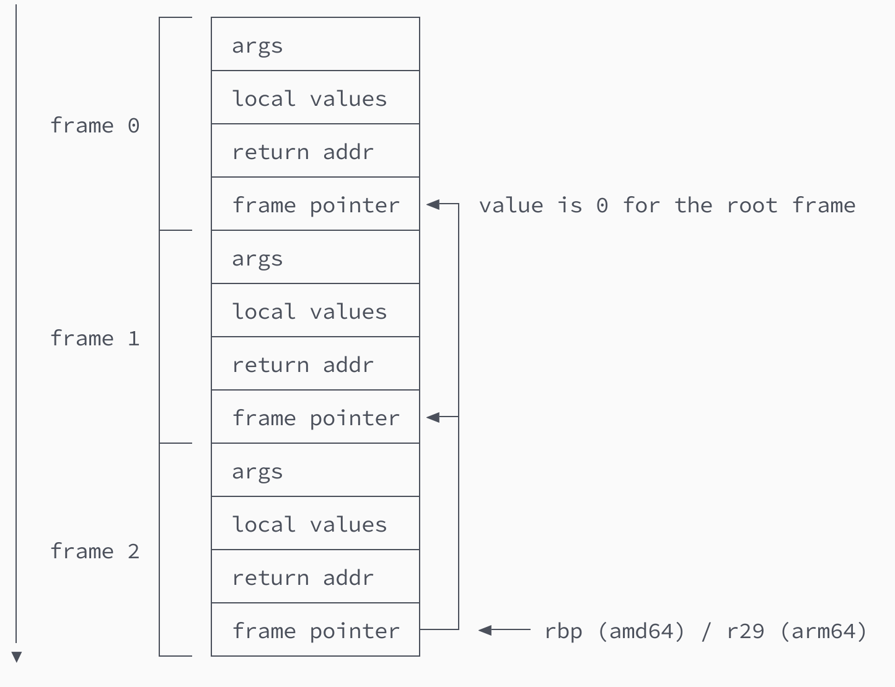
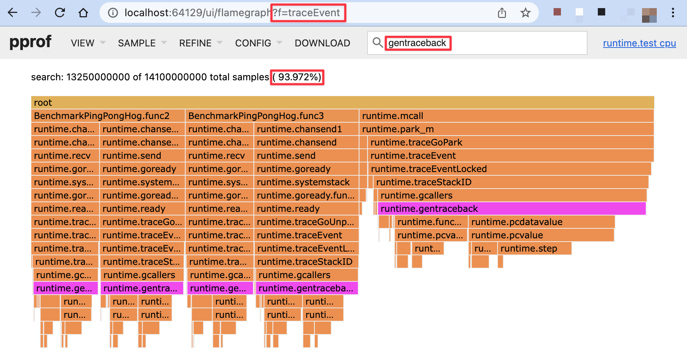
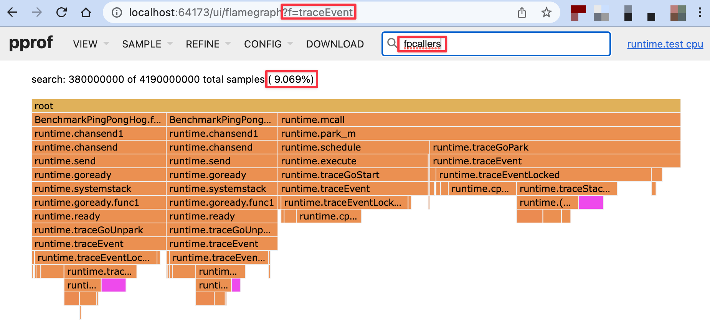

The Go Execution Tracer (aka runtime/trace) was [designed](https://docs.google.com/document/u/1/d/1FP5apqzBgr7ahCCgFO-yoVhk4YZrNIDNf9RybngBc14/pub) to achieve low enough overhead to be usable on "a server in production serving live traffic". This is achieved by writing events into per-P buffers, using RDTSC for timestamps, and encoding into a relatively efficient binary format.

However, one achilles heel has remained since 2014:

> ... 75% of the overhead is stack unwinding.\
> – [Go Execution Tracer](https://docs.google.com/document/u/1/d/1FP5apqzBgr7ahCCgFO-yoVhk4YZrNIDNf9RybngBc14/pub) design doc

Stack unwinding (aka stack walking) is part of the process for taking a stack trace. It involves iterating over all stack frames and collecting the return addresses (program counters) in each frame. It may also involve expanding this list if some of the program counters are part of inlined function calls.

The other part of taking a stack trace is converting these program counters to function names, file names and line numbers. This is usually called symbolization and you can read more about it [here](https://github.com/DataDog/go-profiler-notes/blob/main/stack-traces.md).

So why is stack unwinding so expensive in Go? The short answer is because Go uses a form of asynchronous unwinding tables called gopclntab that require a relatively expensive lookup in order to traverse the stack frames. The gnarly details of this mechanism can be found in the [gentraceback](https://github.com/golang/go/blob/6b8b7823c7fd9f3f2317f657120dc2e965d97b77/src/runtime/traceback.go#L32) function.

It might be possible to optimize the implementation, but it's an uphill battle that we will not investigate today. Instead we'll take a look at another approach: The forgotten art of frame pointer unwinding. It's a technique that has been around for decades, but has fallen victim to relentless compiler optimizations in recent times.

The best way to explain frame pointer unwinding is using a diagram (Fig 1) that shows how to unwind a arm64 stack consisting of 3 frames.

Fig. 1 Traversing a stack of depth 3 using frame pointer unwinding.

The process starts by reading the value of the `r29` (arm64) or `rbp` (amd64) register (aka base pointer). This takes us to the frame pointer of `frame 2`. One word (8 bytes) above this value sits the return address of the caller, which is the first program counter that we need to collect. After this we follow the value of the frame pointer that takes us to `frame 1`, allowing us to discover the second return address. Repeating this process one more time leads us to `frame 0`, which we realize is the root frame because it contains a frame pointer holding the value `0`. So at this point we collect the last return address and stop the process.

If you've paid close attention, you may realize that we have just traversed a linked list outside of a tech interview (Fig 2).

Fig 2 CS101 finally gets its revenge.

As you can imagine, it's not very difficult to implement this, so I decided to turn it into a [small experimental patch](https://go-review.googlesource.com/c/go/+/463835) for the Go runtime. Which brings us back to our original motivation: Can this reduce the overhead of the Go execution tracer?

To answer this question, we'll evaluate the performance of a benchmark called [BenchmarkPingPongHog](https://github.com/golang/go/blob/a106defddac515db4d70e1cad162b88dd026deee/src/runtime/proc_test.go#L491). As the name implies, it essentially measures the performance of two goroutines ping-ponging messages between each other over a pair of unbuffered channels. This is an absolute worst-case for the execution tracer, because each channel operation ends up recording an event with a stack trace.

Exact numbers will vary between different machines, but here is what I usually get when running this benchmark on a beefy `c5n.metal` EC2 machine with tracing disabled vs enabled (Fig 3).

    goos: linux
    goarch: amd64
    pkg: runtime
    cpu: Intel(R) Xeon(R) Platinum 8124M CPU @ 3.00GHz
                   │ baseline.txt │           gentraceback.txt            │
                   │    sec/op    │    sec/op     vs base                 │
    PingPongHog-72    642.8n ± 4%   5616.5n ± 3%  +773.82% (p=0.000 n=10)

Fig 3 Execution tracer overhead for BenchmarkPingPongHog with gentraceback.

774% overhead, yikes. But let's dig in. This data was captured while also running the CPU profiler, so we can easily see that `gentraceback` was responsible for 94% (!) of this overhead (Fig 4).

Fig 4 CPU profile showing 94% of execution tracer overhead in gentraceback.

Now that we've established this baseline, let's see how frame pointer unwinding performs by comparison (Fig 5).

    goos: linux
    goarch: amd64
    pkg: runtime
    cpu: Intel(R) Xeon(R) Platinum 8124M CPU @ 3.00GHz
                   │ baseline.txt │               fp.txt                │
                   │    sec/op    │   sec/op     vs base                │
    PingPongHog-72    642.8n ± 4%   834.8n ± 1%  +29.87% (p=0.000 n=10)

Fig 5 Execution tracer overhead for BenchmarkPingPongHog with frame pointer unwinding.

30% overhead, that's 26 times less overhead than `gentraceback`! I, for one, welcome our new linked list overlords. But before we get ahead of ourselves, let's take a look at the new CPU profile (Fig 6).

Fig 6 CPU profile showing 9% of execution tracer overhead in fpcallers.

As we can see, `fpcallers` is now down to 9% of the tracer's overhead, which means unwinding is no longer the achilles heel of the execution tracer. But of course new bottlenecks such as `cputicks` (28%) and `(*traceStackTable).put` (21%) are starting to emerge. You can take a look for yourself by [downloading the pprofs](https://drive.google.com/drive/folders/10VRje2xPWB6SdXXpK8cWCiZtPpjqUHo7?usp=sharing).

That being said, even without any further optimization, frame pointer unwinding seems to have the potential to take execution trace overhead from [up to 20%](https://gist.github.com/felixge/7ad83a76852b703b4adb5e4afefa1d42#file-1-baseline-vs-gentraceback-txt) to [around 1%](https://gist.github.com/felixge/7ad83a76852b703b4adb5e4afefa1d42#file-2-baseline-vs-fpcallers-txt) for realistic workloads which I'm hoping to explore in a follow-up post.

This raises a final question. If this is so easy, why wasn't the tracer designed to use frame pointers to begin with? The short answer is that the tracer was [added](/2023/01/13/history-of-gos-execution-tracer/) in go1.5, but the Go compiler did not emit frame pointer instructions until [go1.7](https://go.dev/doc/go1.7).

Of course the potential for using frame pointers to optimize the tracer became obvious right away, so there is an [open issue](https://github.com/golang/go/issues/16638) (and [CL 33809](https://go-review.googlesource.com/c/go/+/33809), [CL 212301](https://go-review.googlesource.com/c/go/+/212301)) for it from 2016. However, it kind of stalled, partially because getting a frame pointer unwinder to behave exactly like `gentraceback` is difficult, and partially because no decision was made on whether or not that's a reasonable requirement. Another issue is that frame pointers are only [enabled for amd64 and arm64](https://github.com/golang/go/blob/c8c646d31bec3cbe56ecf5a26fbbd235c97cfb21/src/internal/buildcfg/exp.go#L44-L51), so `gentraceback` will continue to be needed for other platforms regardless. That being said, I'm cautiously optimistic that these hurdles can be overcome by the newly formed [runtime diagnostics working group](https://github.com/golang/go/issues/57175).

Last but not least, there seems to be renewed [momentum](https://lwn.net/Articles/919940/) behind enabling frame pointers for C/C++ applications on Linux where compilers historically disabled them for performance reasons. Those arguments made a lot of sense for 32bit CPUs with limited registers, but they are now being reevaluated. So hopefully the forgotten art of frame pointer unwinding will make a comeback, not just in the tracer, but across the industry as whole. The simplicity and observability benefits would be immense.

**Update**: The frame pointer unwinding discussed in this article was implemented in go1.21, see this [follow-up article](/2023/08/09/debug-go-request-latency-with-datadogs-profiling-timeline/) for more details.
