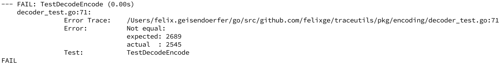
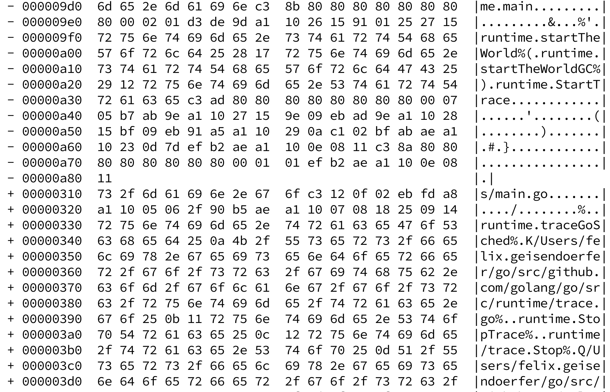
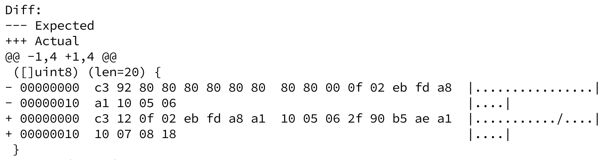

Occasionally I get the chance to work on encoders and decoders for various binary formats. Most recently I worked on [traceutils](https://github.com/felixge/traceutils) which contains a [package](https://pkg.go.dev/github.com/felixge/traceutils@v0.0.0-20230109082159-34de7841cd6b/pkg/encoding) for dealing with the data produced by Go's execution tracer (aka [runtime/trace](https://pkg.go.dev/runtime/trace)).

One common trick for testing such code is **round-trip testing**. The idea is to take an input file that covers many relevant edge cases, read it, decode and then re-encode it. If the output is exactly the same as the input, there is a good chance the implementation is correct.

This works great when the test is passing. But unfortunately it's prone to produce error messages that are too terse as shown in Fig 1 below.

Fig. 1 *This is not enough data to understand the problem.*

Alternatively one might end up with error messages that dump huge amounts of data. That's also difficult to reason about as you can see in Fig 2 here.

Fig. 2 *Oh no, this is too much data! And that's just a small part of it.*

The solution to this problem is simple. Instead of validating the output at the end of the test, one can [incrementally verify the output](https://github.com/felixge/traceutils/blob/07a7195e1e945b528abf52812e5b9e16976560f3/pkg/encoding/decoder_test.go#L63-L67) after every decoding and encoding step. If the implementation is correct, the new data produced after every step should be equal to the input data at the same offset. When it's not, the amount of data that needs debugging becomes much smaller, as can be seen in Fig 3.

Fig. 3 *Yes, that's a comfortable amount of binary data to debug!*

In this case the problem was caused by the input data containing a padded 10-byte varint representation of the value `18` (`0x92 80 80 80 80 80 80 80 80 00`) while the encoder produced a more compact representation of the same value (`0x12`).

Dealing with such cases where the same data has multiple valid representations is a downside of round-trip testing, and maybe I'll explore dealing with it in another post.

Regardless it should be clear that **incremental output verification** makes it much easier to debug round-trip test failures. Of course its a trivial idea and I'm certainly not the first one to come up with it, but let me know if you find it useful.
